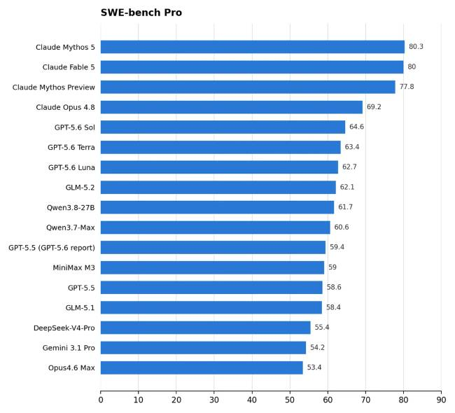
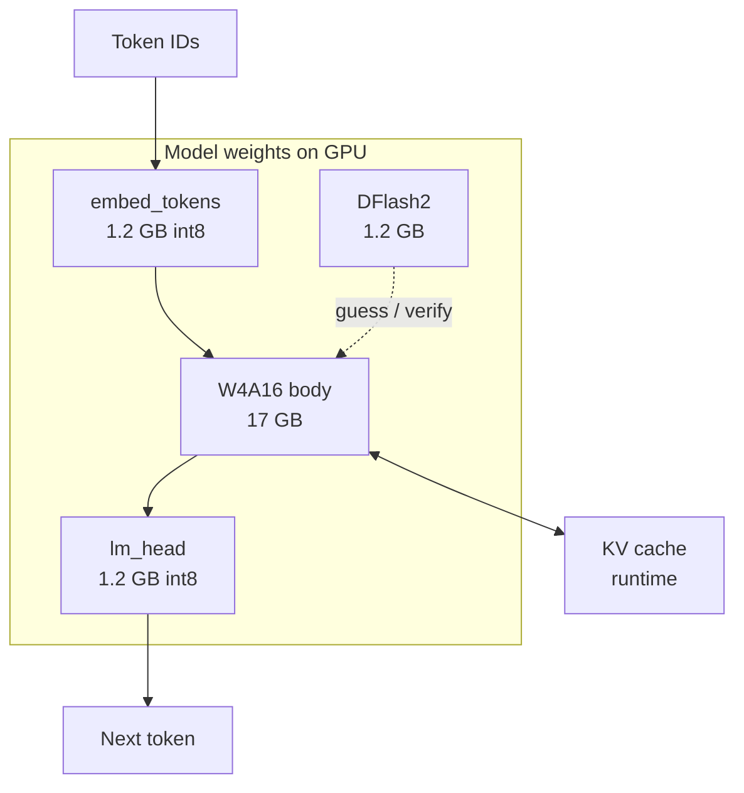

# Adventures In AI Coding 5
## HyperQwen

**[HyperQwen](https://github.com/syv-ai/HyperQwen)** is “Large Qwen models, served fast on the GPUs people actually own.”

Running [Qwen3](https://github.com/QwenLM/Qwen3).8-27b on a 24GB GPU.

Alibaba's family of open-weight LLMs (large language models) released August 2026.

## What

Qwen3.8-27B is a [comparable](https://www.reddit.com/r/LocalLLM/comments/1voam4p/qwen_38_27b_benchmarks_combined_from_model_cards/) top tier open coding model.

Full Qwen3.8-27B stacks up on a hard coding test against famous AIs. 



HyperQwen's W4A16 (4 weights stored ,16bit activations for live math) quantization is a compressed copy of that same 27B model.

I tried it on WSL2 (Windows Subsystem for Linux) Ubuntu, RTX 4090 **24 GB VRAM (GPU memory)** card minus 1.2GB for Windows, 27 GB system RAM, driver 610.88, GPU power limit 450 W, Python venv.
[HyperQwen's WSL2 + 4090 notes](https://github.com/syv-ai/HyperQwen/blob/main/docs/wsl2-4090.md)

---

## Why

The cloud is someone else’s computer.

In [Adventure #3](https://github.com/Vince-0/AdventuresInAICoding3) I made **small models that already fit** go faster with MTP (Multi-Token Prediction). 

In [Adventure #4](https://github.com/Vince-0/AdventuresInAICoding4) I ran **MoE (Mixture-of-Experts) bigger than VRAM** via host-RAM offload.

This round asks a different question: what does a **dense, strong open model** (Qwen3.8-27B) look like on 24GB VRAM

Vanilla Qwen 3.8 BF16 (16-bit full-precision) 27B full weights at **56GB** does not fit in 24GB VRAM. 

A community Qwen 3.8 **W4A16** quantization at **22GB** + KV (key-value) cache + context almost does. 

HyperQwen is a [vLLM](https://vllm.ai/) server engine patch + weight recipe that finishes that fit (**including a DFlash2 drafter model**) and documents how to serve it.

<details>
<summary><strong>Key concepts</strong></summary>

Primer (how LLMs, attention, and KV work): [AI Theory](https://github.com/Vince-0/AI_Theory)

New in this write-up:
- Block guesses
- Two HyperQwen harness jobs (invent vs sticky) on a shared 96k window
- Copying from the prompt
- Prefix cache; warm vs cold measurement
- Smaller conversation memory so long chats fit. 

### Glossary

| Term | Meaning | On this run |
|------|---------|-------------|
| **VRAM** | Memory on the GPU. The model has to live here to run quickly. | Card is **24 GB**, but under WSL + Windows display roughly **0.7–1.2 GB** is already used (WSLg / `Xwayland`). Usable for the server is about **22.8–23.3 GB**. |
| **Dense 27B** | One model that runs every layer for every token. | Qwen3.8-27B. Different from [#4](https://github.com/Vince-0/AdventuresInAICoding4), where specialist layers sat in system RAM. |
| **W4A16** | Weights stored in 4-bit. Math done in about 16-bit. | How 27B fits on one 4090. |
| **[GPTQ](https://arxiv.org/abs/2210.17323)** | **G**enerative **P**re-trained **T**ransformer **Q**uantization: a calibration method that squeezes weights to W4A16 instead of only rounding each number. | How the DFlash2 drafter was shrunk (3.85 GB BF16 → 1.2 GB). The main 27B body used AutoRound instead. |
| **KV cache** | Memory of what the model has already read in this chat. | Longer chats and bigger pasted docs use more of it, so less VRAM is left. |
| **Prefill vs decode** | **Prefill** = first big read of the prompt (builds KV). **Decode** = write the reply one token at a time. | Fat `@file` / paste is mostly prefill (time + VRAM scratch). Chat snappiness is mostly decode tok/s. |
| **Frozen vLLM + HyperQwen** | A known vLLM version, plus patches and scripts that were tested together. | Install, patch, prepare weights, `start_qwen.sh`. |
| **Speculative decoding** | A small model guesses the next tokens. The big model accepts or rejects them. | [#3](https://github.com/Vince-0/AdventuresInAICoding3) used MTP for this. Here the guesser is DFlash2. |
| **DFlash2** | The guesser proposes a block of tokens. The 27B model checks the block. | `SPEC=dflash2` for both practical use cases. |
| **Lookup drafting** | If the reply is mostly text already in the prompt, take those tokens from history. | Speed win inside Use case B when refactoring or quoting what is already in context. |
| **Prefix cache** | Keep the KV for a prompt you will send again, so the next turn skips re-reading it. | First fat read is slow. Second turn on the same prefix is where agents feel fast. |
| **Warm** | A measured turn after the server has already been chatting; caches may already be filled. | Invent-code (mergesort): short prompt, long reply — we care about **decode**. |
| **Cold** | A measured turn the **first** time a fat prompt is seen; no prefix-cache hit yet. | Sticky quote (about 25k): tiny reply — we care about **TTFT / prefill**. |
| **`-fast` weights** | Extra repack of a few hot parts (output head and draft bits). | Used automatically when those files are present. |
| **Context / KV** | How the server stores “what I’ve already read,” which sets how long a chat can be. | Daily: **int8 KV at 96k** — shared A/B window on this WSL box. |
| **Marlin repack** | At startup, rewrite the 4-bit weights into a layout the GPU kernels want. | Can run out of memory on WSL if the allocator setting is wrong. See Issues. |

---

</details>

### Ways to run a local model

| Approach | Pros | Cons |
|----------|------|------|
| **HyperQwen** | Custom vLLM patch + weights, **fastest decode** DFlash2 | Medium context |
| llama.cpp GGUF (model file format) | GGUF package, largest dense context, MTP | Slower decode than HyperQwen |
| llama.cpp + **DSpine** | Same GGUF target + DSpine draft; beats MTP on invent | Needs [Ajay9o9 `dspine` fork](https://github.com/Ajay9o9/llama.cpp/tree/dspine) (not stock llama); loses to HyperQwen DFlash2 on prose **and** code |
| FreeToken dense | Same Qwen3.8 family on FreeToken | Big weights = small context |
| FreeToken MoE | MoE bigger than VRAM (experts in RAM); **largest context** | Different model (3.6-A3B); PCIe (GPU↔CPU bus)/CPU-bound decode |
| Stock vLLM | Stock engine, serves a model that fits | DIY config long-context, DFlash, and requant |

**How they fit on this 24 GB card**

**Decode A / B** in the table = invent-code speed under invent vs sticky **draft settings** (mergesort job; quality 3/3). The two *jobs* themselves are spelled out under [The two use cases](#the-two-use-cases). For sticky, warm prefill tok/s (tokens per second) can look huge because of the **prefix cache** — compare **cold** sticky prefill when reading phase timings.

| Approach | Weights (model/quant) | Size | KV | Context | Decode A / B | Why |
|----------|----------------------|------|----|---------|-------------:|-----|
| **HyperQwen** | Qwen3.8-27B W4A16 + **DFlash2** | 15GB+1.2GB | int8 5GB | 96k | **234 / 177** | Lean weights + quantized KV |
| llama.cpp GGUF | Qwen3.8-27B UD-Q4_K_M GGUF | 16GB | **q4_0** 5GB+ | 180k | **91 / 93** | Leanest KV bytes/tok; no invent-vs-sticky draft setting — B is invent-code on the same MTP config |
| llama.cpp + **DSpine** | UD-Q4_K_M + [DSpine-b16 Q4_K_M](https://huggingface.co/aj9o9/Qwen3.8-27B-DSpine-b16-GGUF) | 16GB+1.3GB | **q4_0** about 5GB+ | **96k** A / **65k** B | **182 / 196** | A n-max 7 @96k; B n-max 15 needs about 65k on 24 GB (faster on code) |
| FreeToken dense | Qwen3.8-27B NVFP4 (NVIDIA 4-bit float) + host embeds | 20GB+2.4GB | no quant 4GB | 48k | **40 / 41** | Weights eat most of the card; no invent-vs-sticky draft setting — B is invent-code on the same config |
| FreeToken MoE | **Qwen3.6-35B-A3B** NVFP4 | 22GB | no quant 5GB + host experts | **256k** | **45 / 46** | Experts off GPU → room for KV; decode PCIe/CPU-bound; no invent-vs-sticky draft setting — B is invent-code on the same config |

I like the vanilla llama.cpp GGUF approach for a good context size and decode speed.

### Context size

Context size is how much of the conversation + pasted files the model can “see at once” (in tokens).

Past that limit, older stuff falls out of the window and the model literally cannot read it anymore.

Agents and coding jobs need the working set in-window (the file you’re editing, the error log, the plan, prior tool results). 

If that doesn’t fit, the model forgets, re-asks, or invents from a truncated view.

Practical example:

You’re fixing a bug with OpenCode. The harness pastes src/parser.py (8k tokens), the failing test (2k), and the last 20 tool turns (30k). That’s already 40k.

- **HyperQwen at 96k** still has room for a second code module + a longer plan.

- **llama at 180k** can keep a fat multi-file /plan without constantly re-attaching files.
  
- **FreeToken dense at 48k** it's near the ceiling, one more large file and something drops.

- **FreeToken MoE at 256k** can hold that whole working set and still leave room for more files or a longer plan (different model: Qwen3.6-A3B).

So bigger context isn’t “smarter IQ”, it’s how much of the job stays visible without the harness re-feeding or the model guessing.

### Key-value cache

KV = the model’s scratchpad for “tokens I’ve already seen,” kept on the GPU so the next token stays faster.

Different engines store that scratchpad at different precision / layout, so the same context costs different GB.

- **HyperQwen: int8 5GB** stored at 8-bit not the full 16-bit, at 96k context.

- **llama.cpp: q4_0 5GB** stored at 4-bit; VRAM cost scales with context so 180k still fits this card.

- **FreeToken dense: no quant 4GB** (hybrid layout, not int8/q4); with 20GB weights there isn’t much room for more than 48k context.

- **FreeToken MoE: no quant 5GB** (hybrid layout). Experts live in system RAM, so the GPU keeps less weight and has room for KV at 256k.

---

## How

**[HyperQwen](https://github.com/syv-ai/HyperQwen)** patches [vLLM](https://github.com/vllm-project/vllm) inference engine with:
- [DFlash2 guessing](#dflash2)

- Copying from the prompt: if the answer is mostly text already in what you pasted (quote this, edit that), the server can grab those words from the prompt instead of inventing
  them. The big model still checks.
  
- Long-context KV: this lab uses **int8 KV** at **96k**; fat **prefill** is what breaks WSL if you push past that.

- WSL offload device-pointer handling: under WSL, CPU↔GPU “shared” memory pointers don’t behave like real UVA (Unified Virtual Addressing). HyperQwen’s [`offload-wsl2-devptr`](https://github.com/syv-ai/HyperQwen/blob/main/patches/offload-wsl2-devptr.patch) patch fixes how the offload path reads those pointers so it doesn’t trust a broken mapping.

- CUDA-graph / memory accounting quirks (especially painful on WSL): the WSL driver can report free GPU memory as zero or collapse during cold compile, so a stock memory estimate refuses to boot. HyperQwen patches measure graph memory from the allocator instead ([`cudagraph-memory-from-allocator`](https://github.com/syv-ai/HyperQwen/blob/main/patches/cudagraph-memory-from-allocator.patch)) and clear leftover compile scratch before pinning the KV pool ([`pinned-kv-empty-cache`](https://github.com/syv-ai/HyperQwen/blob/main/patches/pinned-kv-empty-cache.patch)).
 
They then [optimize](https://github.com/syv-ai/HyperQwen/blob/main/docs/optimizations.md) a stock 4-bit Qwen3.8 model that almost fits, shrink the parts that still don’t, and add the small helper models the patched server expects. 

[Quality](https://github.com/syv-ai/HyperQwen/blob/main/docs/quality.md):
Vanilla Qwen3.8-27b is about 56GB on disk, this W4A16 build is about 22GB.

The W4A16 quantization is a lossy compression of the weight numbers

The difference between the vanilla model and the quantized model is measured by:
  1. Task scores: with [IFBench](https://github.com/allenai/IFBench), give the model a fixed quiz (math, follow instructions, etc.). Count how many it gets right. Compare full model vs 4-bit.
  2. Perplexity: with [quality battery](https://github.com/syv-ai/HyperQwen/blob/main/bench/quality_battery.py) show the model text it hasn’t seen and ask: how unsurprised are you by the next word? Lower = less surprised. If perplexity goes  up after quantization, the model got a bit worse at predicting normal text. 
  3. Round-trip error: Take one weight number → squash it to 4-bit → expand it back → compare to the original = 0.6% 

**Steps**

Python venv and HyperQwen’s `docs/install.md`.

1. Clone [HyperQwen](https://github.com/syv-ai/HyperQwen). `.env` has `SPEC=dflash2`, `PREFIX_CACHE=1`, `VLLM_WSL2_ENABLE_PIN_MEMORY=1`, `HOST=127.0.0.1`, `GPU_UTIL=0.90`.
2. `pip install vllm==0.32.0` (plus the pinned deps). `bash patches/apply.sh`.
3. Prepare weights: AutoRound W4A16, then `-fast`, then the DFlash2 drafter (`prepare/` scripts).
4. WSL / driver 610.x boot fix:  
   `PYTORCH_CUDA_ALLOC_CONF=expandable_segments:False,max_split_size_mb:128`  
   `expandable_segments:False` alone runs out of memory during Marlin. `:True` dies while KV is starting.
5. `bash single-user/start_qwen.sh` → `http://127.0.0.1:18020/v1` (name `qwen3.8-27b`).
6. **Use case A:** leave `DFLASH_TOKENS` unset (7); shared **96k** int8 KV window.
7. **Use case B:** same 96k window; set `DFLASH_TOKENS=15` and restart .

Set variables and start:
```bash
cd $HOME/LLM/HyperQwen
set -a && source .env && set +a
# Daily profile: int8 KV at 96k
export PATH="$PWD/venv/bin:$PATH"
bash single-user/start_qwen.sh
curl -s -H "Authorization: Bearer $VLLM_API_KEY" http://127.0.0.1:18020/health
```

For short quizzes and for agents like Hermes, turn **thinking off** (`chat_template_kwargs.enable_thinking=false`). If thinking is on, the reply budget fills with reasoning and `content` comes back empty.

**Thinking**

Some models can “think out loud” before they answer. That private scratchpad is called thinking (also: reasoning / chain-of-thought).

The useful reply you see is content. Tools an agent wants to run are separate from both.

Every reply has a budget (max_tokens / limit.output) — how many tokens the server is allowed to emit in that turn. 

Thinking, the visible answer, and tool calls all share that same budget.

If thinking is on and the budget is small (e.g. 8k), the model can spend the whole budget on “let me reason…” and then stop. You get:
- lots of hidden reasoning
- empty or nearly empty content
- no tool calls (Hermes / OpenCode look stuck or broken)

If thinking is off, almost every token goes to the real answer or to tools. Short quizzes get a clean graded reply. 

Agents get tool calls instead of a full belly of private monologue.

For short quizzes and for agents like Hermes, turn thinking off — not because thinking is “bad,” but because it fills the reply budget first, and what’s left may be zero for the answer or for tools.

--- 

**How the pieces fit together:**



How to read it:

| Piece | Role |
|-------|------|
| **Token IDs** | Your prompt, as numbers |
| **`embed_tokens` int8** | Front door: IDs → vectors |
| **DFlash2** | Side helper that guesses a short block; the body accepts or rejects (HyperQwen Mode A 7 / Mode B 15) |
| **W4A16 body** | Almost all of the 27B layers, stored 4-bit (AutoRound) |
| **KV cache** | Remembers this chat; daily path is **int8 at 96k** |
| **`lm_head` int8** | Back door: vectors → “which word next?” |
| **Next token** | Final scores → the word that gets emitted |

- **More than two things share the GPU.** Under WSL, Windows display already uses about **1.2 GB**. The rest is for weights, the drafter, KV, and short-lived prefill scratch. A longer chat does not make the weight file bigger; it grows the KV until that usable pool is full.

- **Guess, then check.** DFlash2 proposes a short phrase. The 27B model marks which tokens are right. When the guesses are often right, the reply finishes in fewer full-model steps.

- **Same weights, same 96k window, two jobs.** A and B share the daily int8 96k window. HyperQwen Mode A/B only changes draft check length (7 invent vs 15 copy).

- **Copying from the prompt is cheaper than inventing.** Lookup fills guesses from text already in the prompt. The prefix cache reuses KV for the shared front of the prompt. The first read of a long doc is still slow. The next turn on that same doc is where an agent feels fast.

- **Prefill is the cliff.** Reading a fat prompt builds KV and needs spare VRAM; that is where WSL dies, not “decode tok/s.”

- **Two ways this recipe shrinks memory.** W4A16 shrinks the weights. `-fast` repacks a few hot parts. The KV path here is plain **int8** at 96k and keep headroom for prefill.

---

### The two use cases

We do **not** score “the model in general.” We score two jobs a coding agent actually does: **write new code** vs **find something already in a fat paste**.

**Use case A — invent (write new code)**

Ask:

> Write a complete Python function that implements mergesort on a list of ints. Include docstring and a small `__main__` demo. Keep going until the length limit.

- Budget: **1536** completion tokens (enough to finish; models stop earlier with `finish=stop`).
- Pass: extract the Python → run it → it must correctly sort fixed lists **and** random int lists.
- What it feels like: OpenCode invent-loop, “implement this function,” pair-programming from a blank reply.
- On HyperQwen we boot invent draft length **n=7** (`DFLASH_TOKENS=7`).

**Use case B — sticky (quote from a fat document)**

Paste a long filler document (about **25k** prompt tokens) that hides a marker near the end, then ask only:

> Quote the secret phrase from the document exactly, nothing else.

- Pass: the reply contains the marker (e.g. `UNIQUE_MARKER_QZ9_MODE_B`).
- Reply is tiny (about 9 tokens); the hard part is **reading** the fat prompt not writing a long answer.
- What it feels like: `/plan`, fat `@file`, “quote this,” in-context edit — the answer is already in what you pasted.
- On HyperQwen we boot sticky draft length **n=15** (`DFLASH_TOKENS=15`) so lookup can copy from the prompt.

| | **A invent** | **B sticky** |
|--|--------------|--------------|
| **Job** | Create new code | Reuse text already in the prompt |
| **Prompt** | Mergesort + docstring + `__main__` | about 25k doc + “quote the secret phrase…” |
| **Quality check** | Exec sort tests | Marker present in reply |
| **Speed that matters** | **Decode** tok/s (long reply) | **TTFT (time to first token) / prefill** tok/s (fat read; short reply) |
| **HQ draft knob** | n=7 | n=15 |

Same 27B weights and (on HyperQwen) the same **96k** window — only the **job** and the **draft check length** change.

---

### DFlash2

A small helper model (**DFlash2**) guesses the next few words. The 27B model checks that guess in one step. Checking a short block is faster than generating one word at a time with the full model.

The project title is [**DFlash: Block Diffusion for Flash Speculative Decoding**](https://github.com/z-lab/dflash) so the **D** is about **block diffusion**, and **Flash** is the “fast speculative decode” part. **DFlash2** / **DFlash 2** is the second generation of that drafter.

DFlash2 is **not** a slice of the 27B weights. It is a separate **about 1.92B**-parameter draft model. The original is BF16 (**about 3.85 GB**): [incoai/Qwen3.8-27B-DFlash2](https://huggingface.co/incoai/Qwen3.8-27B-DFlash2). HyperQwen serves a smaller copy (**about 1.2 GB**) made with [GPTQ](https://arxiv.org/abs/2210.17323) (Generative Pre-trained Transformer Quantization). That file is [syvai/Qwen3.8-27B-DFlash2-W4A16](https://huggingface.co/syvai/Qwen3.8-27B-DFlash2-W4A16) ([`prepare/fetch_dflash2.py`](https://github.com/syv-ai/HyperQwen/blob/main/prepare/fetch_dflash2.py)).

| | Main Qwen body | DFlash2 drafter |
|--|----------------|-----------------|
| **What** | The big 27B | The small about-1.92B guesser |
| **Method** | **AutoRound** (shipped as compressed-tensors) | **[GPTQ](https://arxiv.org/abs/2210.17323)** (HyperQwen `drafter/quant_dflash2.py`) |
| **Idea** | Round with AutoRound’s calibration | Round with GPTQ’s calibration (Hessian / error feedback) |
| **Result label** | W4A16 | Also W4A16 but GPTQ |

HyperQwen preparation: [drafter/README.md](https://github.com/syv-ai/HyperQwen/blob/main/drafter/README.md).

  1. Download an already 4-bit Qwen (the public W4A16 AutoRound / compressed-tensors build). Most of the 27B body is already small enough for 24 GB.

  2. That public file still wastes VRAM, so prepare/ rewrites a few leftover full-size pieces once, on the CPU, in place:
    • lm_head (output layer) → int8 
    • embed_tokens (input embeddings) → int8 
    • mtp.* (built-in draft module, if present) → int8

  3. Build a smaller draft vocabulary — a 41k-row slice of the output head so a draft model doesn’t score the full 248k vocab every guess.

  4. Optional downloads for speed:
    • -fast — further-tweaked head/draft bits (15% faster in single-user mode)
    • DFlash2 — the separate small block-guesser HyperQwen uses 

#### DFlash2 vs MTP vs DSpine

Same idea (guess → big model checks), different guesser.

| | **MTP** | **DFlash2** | **DSpine** |
|---|---------|-------------|------------|
| **What guesses** | Small **heads baked into** Qwen3.8 (`nextn`) | **Separate** about 1.9B draft model | **Separate** five-layer draft; reads 5 target hidden layers |
| **How it guesses** | Next few tokens from those heads | Block draft (diffusion-style) | Parallel 16-token block + code bridge + last-write refine ([paper](https://arxiv.org/abs/2609.36173)) |
| **Extra files** | Often already in the GGUF | W4A16 drafter (HyperQwen) | [DSpine-b16 GGUF](https://huggingface.co/aj9o9/Qwen3.8-27B-DSpine-b16-GGUF) (about 1.3 GB Q4_K_M) |
| **Typical home** | Stock llama.cpp `draft-mtp` | HyperQwen `SPEC=dflash2` | [Ajay9o9 llama.cpp `dspine`](https://github.com/Ajay9o9/llama.cpp/tree/dspine) only (stock llama refuses the file) |
| **On this box @ 96k** | prose **74** / code **90** (MTP n=2) | prose **134** / code **232** (DFlash2 n=7) | prose **81** / code **138** (DSpine n=7); usable sticky **about 97.7k** |

MTP = the model’s **built-in mini-crystal-ball**.

DFlash2 = a **sidekick model** that blurts a whole short guess for the big model to mark right/wrong.

DSpine = a **deeper sidekick** (extends the DFlash family): longer parallel drafts, hungrier for VRAM when `n-max` is high (n-max 15 → about 65k boot on 24 GB; n-max 7 keeps the **96k** window comparable to HyperQwen).

---

## Results

| Metric | Definition |
|--------|------------|
| **TTFT** | Time to first streamed content token |
| **Prefill tok/s** | `prompt_tokens / TTFT` |
| **Decode tok/s** | `(completion_tokens − 1) / (wall − TTFT)` |

| Job | Bottleneck | So we report |
|-----|------------|--------------|
| Use case A: warm invent | long **write** | warm TTFT + **warm decode** |
| Use case B: cold sticky | fat **read** | **cold TTFT** + **cold prefill** |

**Warm** = short question, long answer, after the server has already been chatting a bit.

You ask for a mergesort. The prompt is tiny (about 80 tokens). The model then **writes a lot of code**. What you feel is how fast those output tokens stream — that’s **decode**. TTFT is almost nothing because there’s almost nothing to read first.

“Warm” means a prior turn already filled caches, so we’re not pretending this is the first breath of the day. We care about the **writing** phase.

**Cold** = fat document dumped in, tiny answer, **first** time that document is seen.

You paste about 25k tokens of “repo” with a secret phrase buried in it and say “quote the secret.” The reply is a few words. Almost all the work is **reading** the fat prompt before the first token — that’s **TTFT / prefill**.

“Cold” means no prefix cache for that blob yet. If you measured the **second** sticky turn instead, prefill would look insanely fast (cache hit) and lie about how hard the first fat `/plan` feels.

Same GPU, same window idea — two different jobs, so you don’t squash them into one tok/s number.

People usually ask one question: how many tokens per second? That misses this write-up. A server that feels snappy on short invent turns can still fail a fat repo `/plan`, and the other way around so scores are tied to **two jobs on one fixed window**, not a single tok/s number.

**What we hold fixed** (biggest stable usable context on this WSL box):

- **int8 KV** at **96k**
- Same weights for both jobs: **invent (A)** and **sticky (B)** on that **shared 96k** window (only draft check length changes: 7 vs 15)

DSpine B is n-max 15 @ **65k**; others on the shared **96k** window where noted.

| Stack | Warm TTFT (s) | Warm decode | Cold TTFT (s) | Cold prefill tok/s |
|-------|--------------:|------------:|--------------:|-------------------:|
| **HyperQwen** DFlash2 n=7 | 0.11 | **253** | — | — |
| **HyperQwen** DFlash2 n=15 | 0.08 | 256 | 13.6 | 1847 |
| llama.cpp **DSpine** n=7 @96k | 0.11 | 196 | **8.4** | **3012** |
| llama.cpp **DSpine** n=15 @65k | 0.10 | 219 | 8.6 | 2914 |
| llama.cpp **MTP** n=2 | 0.10 | 100 | 8.7 | 2894 |
| FreeToken dense | 0.08 | 44 | **821** | 31 |
| FreeToken MoE | 0.97 | 38 | 7.2 | **3499** |

---

## Agents (Hermes, OpenCode, OmO)

Same pattern as earlier adventures: a local OpenAI-compatible server, plus a harness in front of it. 

This time the harness can plan, call tools, and write files.

```text
# Direct API, Hermes, short tests
base_url = http://127.0.0.1:18020/v1
model    = qwen3.8-27b
# Prefer chat_template_kwargs.enable_thinking=false

# OpenCode + oh-my-openagent (OmO)
# The proxy turns thinking off and raises max_tokens if the client sends a tiny cap.
base_url = http://127.0.0.1:18021/v1   # proxy in front of :18020
model    = hyperqwen/qwen3.8-27b       # $HOME/.config/opencode/opencode.json
```

- Hermes one-shot returned **`PHASE7_OK`** (temporary `model.base_url` override, then put back).
- Use case A invent-loop smoke (`fizzbuzz`) passed in about **0.64 s**.
- Use case B sticky quote on **96k** passed through **25138** prompt tokens (see Results).
- **OpenCode 1.19.5 + oh-my-openagent** on Use case A built a playable **`$HOME/LLM/web-tetris`** (`index.html`, `game.js`, `style.css`, `README.md`) with real tool calls (`write`, `edit`, `bash`).

### OpenCode on this server

I wanted HyperQwen behind an OpenCode-style agent: plan, tools, files. Invent-loop tok/s alone does not show whether that loop works. 

The Tetris run is **Use case A**. A sizeable-repo `/plan` is **Use case B** on the **same 96k** window (raise OpenCode `context` toward 96k).

What ran:

| Layer | Setting |
|-------|---------|
| Server | Use case A invent-loop: `SPEC=dflash2`, n=7, **65k** window, port 18020 |
| Harness | OpenCode + `oh-my-openagent@latest`. Agents in `$HOME/.omo/omo.jsonc` point at `hyperqwen/qwen3.8-27b`. |
| Proxy | `HyperQwen/bench-results/thinking_off_proxy.py` on port **18021**. Forces `enable_thinking=false` and raises `max_tokens` if it is too low. |
| OpenCode limits | `context: 65536`, **`output: 32768`**. It was **8192**, which was too small. |
| GPU concurrency | `background_task.providerConcurrency.hyperqwen: 1` |

What I learned:

1. **Thinking ate the tool budget.** With thinking on and `limit.output: 8192`, a Tetris step finished with `finish_reason=length`, about **8192 reasoning tokens**, **0 output tokens**, and **no tool calls**. The same prompt with thinking off called tools right away. For an agent loop, turn thinking off, or give reasoning a budget large enough that tools still fit.
2. **8192 was an OpenCode limit, not a HyperQwen limit.**. Use case A’s window here is 65k total. A practical output cap is **16k–32k** (I use **32768**), so the prompt, tools, and history still fit. Later steps were often already **20k–40k** of input. Do not set the output cap equal to `max_model_len`.
3. **Tool calling works.** HyperQwen’s `qwen3_coder` path, through OpenCode’s OpenAI-compatible client, did multi-step `write` / `edit` / `bash`. Try a one-file write before a large job.
4. **The prefix cache matters.** Later agent turns showed a large **`cache.read`**. A **65k** window was enough for a small web game. A bigger repo is Use case B on **96k** — test whether that ceiling is enough in a real session.
5. **How I run it.** Port 18020 for invent-loop chat and short tests. Port 18021 (the proxy) for OpenCode/OmO. `--auto` for unattended runs. Keep HyperQwen concurrency at **1** on this 4090.

```bash
# Boot HyperQwen, then:
export HYPERQWEN_API_KEY="$(grep '^VLLM_API_KEY=' $HOME/LLM/HyperQwen/.env | cut -d= -f2)"
python3 $HOME/LLM/HyperQwen/bench-results/thinking_off_proxy.py &   # :18021
export PATH="$HOME/.bun/bin:$HOME/.opencode/bin:$PATH"
opencode run --dir $HOME/LLM/web-tetris -m hyperqwen/qwen3.8-27b --auto "…"
```

---

## Issues

| What happened | What I did |
|---------------|------------|
| No `docker` in WSL | Python venv, following `docs/install.md`. |
| Out of memory during Marlin load | `PYTORCH_CUDA_ALLOC_CONF=expandable_segments:False,max_split_size_mb:128` |
| `BIND=` ignored on the venv start script | Use **`HOST=127.0.0.1`**. |
| Thinking fills `max_tokens` and `content` is null | `enable_thinking: false` for quizzes and for OpenCode/OmO (proxy on 18021). |
| OpenCode: `length`, `reasoning=8192`, `output=0`, no tools | Thinking used the whole output cap. Turn thinking off and set **`output` to 32k**. |
| Use case B sticky OOM (out of memory) / WSL hard reset | Card is 24 GB; Windows/WSLg already uses **1.2 GB**, so usable is **23 GB**. **Do not raise** the KV budget above the profile default. On the **96k** profile, **lower** KV budget and cap context length. Quote then passed through **25138** prompt tokens (targets 4k→24k). |
| `VLLM_WSL2_ENABLE_PIN_MEMORY=1` fails Marlin load | Boot with **`pin_memory=0`** on this box for now. |
| FreeToken `--moe-cache-auto` on the 4090 | Out of memory. Pin moe and KV for the comparison. |
| Abliterated W4A16 as a drop-in (leminkozey) | Heavier than `-fast`. DFlash/MTP unpack OOMs or hard-crashes WSL. Not an invent-loop substitute unless you run `SPEC=off` and a smaller KV. |
| A VRAM OOM sometimes kills the whole WSL distro | Same cliff as a CUDA OOM. Leave headroom. |
| Cold compile plus stock graphs at 450 W reset WSL twice | Quiet boot (don’t spam `nvidia-smi`). Let the torch.compile cache warm. Then a stock full graph, CG=64, boots cleanly. |
| Fat context / prefill beyond 96k | WSL/DWM (Windows Desktop Window Manager) risk. Stay on **int8 96k**; don’t raise the KV budget to “buy” more window. |

---

## Lessons

1. **Use case A and Use case B are two jobs on one server.** Shared **96k**; A is invent (n=7), B is sticky (n=15 when copying the prompt). The upstream 381 tok/s figure is copy-from-prompt, not invent-loop.
2. **The useful part is the recipe.** Pinned vLLM 0.32.0, the patch set, `-fast` weights, DFlash2, and **int8 96k**. A checkpoint by itself is not that.
3. **Lookup and the prefix cache are what make sticky agents feel fast.** Mode B (15) helps when the answer reuses the prompt. The prefix cache makes the second turn cheap after the slow first read.
4. **Daily = int8 96k.** That is the biggest stable usable window here. Fat prefills past it can still WSL-reset or DWM-crash the desktop. Next: real harness at 96k.
5. **Quiz score, speed, and context are separate.** Use case A is faster than gpt-oss on this 4090 and loses the quiz (14 vs 20 out of 24). Pick the server for the job.
6. **The WSL allocator setting is part of the install.** `max_split_size_mb:128` was required on driver 610.x.
7. **A different weight file can blow the VRAM budget.** An abliterated AutoRound build without `-fast` used the room DFlash needs. Stock HyperQwen use case A stays the daily invent-loop server.
8. **An agent harness is not a chat quiz.** OpenCode/OmO needs thinking off, a large `limit.output` (about 32k here), and a small proxy. 8k with thinking on returns no tool calls and no error that says why.

### HyperQwen vs a typical vLLM install

| | Typical vLLM | HyperQwen |
|---|----------------|-----------|
| Version | You track upstream and patch yourself | vLLM **0.32.0** plus a tested patch set |
| Weights | You bring a quant | A **W4A16** path, **`-fast`**, and a **DFlash2** prepare script |
| Speculation | Optional, several drafters | **DFlash2**, with HyperQwen Mode A/B as the check length under each job |
| Long context | You pick KV dtype and length | **int8 96k** is the shared A/B window here |
| WSL | Whatever you find in issues | Pin-memory flag and the allocator setting above |

### When llama.cpp is the better tool

Use llama.cpp for the GGUF ecosystem, for MTP on small models, or for abliterated GGUF trials.

Use HyperQwen when the job is dense Qwen3.8-27B on one 24 GB card, an OpenAI-compatible API.

### What I'd use

- Leave **Use case A @ 96k** for daily invent-loop.
- For **OpenCode / OmO**, use the thinking-off proxy on **port 18021** and **`limit.output: 32768`** (raise OpenCode `context` toward 96k when the client allows).
- Flip to **Use case B** for sticky quote research/refactor.

---

## Reflections

On a 4090 with about 27 GB of system RAM, both use cases share a **96k** window, the **real ceiling to stress in user/harness sessions** on this WSL box (still short of many 128k–200k+ clouds). Usable VRAM is about **23 GB** after Windows/WSLg. Fresh A/B invent-**code** (mergesort) decode: **A 234 / B 177** tok/s (quality 3/3 both; n=15 is slower on invent-code). Sticky quote through **25138** prompt tokens. 

HyperQwen gave a fast Qwen3.8-27B server but llama.cpp MTP gave a sufficiently fast Qwen3.8-27B server with much larger context.
