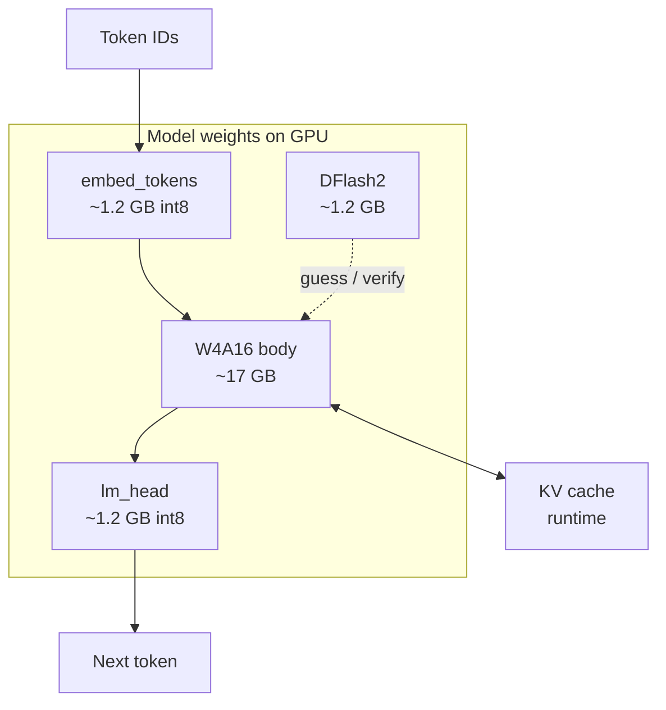

# Adventures In AI Coding 5
## HyperQwen

Running Qwen3.8-27b on 24GB VRAM.

## What

“Large Qwen models, served fast on the GPUs people actually own.”

[HyperQwen](https://github.com/syv-ai/HyperQwen) patches [vLLM](https://github.com/vllm-project/vllm) inference engine with DFlash2 guessing, copying from the prompt, long-context KV tricks, WSL pin-memory fixes and more.
They then [cook](https://github.com/syv-ai/HyperQwen/blob/main/docs/optimizations.md) a stock 4-bit Qwen that almost fits, shrink the parts that still don’t, and add the small helper models the patched server expects. 

[Quality](https://github.com/syv-ai/HyperQwen/blob/main/docs/quality.md):
Vanilla Qwen3.8-27b is about 56GB on disk, this W4A16 build is about 22GB.
W4A16 means weights (small stored recipe) are stored in 4-bit with 16-bit activations(richer live math) values during the forward pass.
The W4A16 quantization is a lossy compression of the weight numbers

The gap between the vanilla model and the quantized model is measured by:
  1. Task scores: with [IFBench](https://github.com/allenai/IFBench), give the model a fixed quiz (math, follow instructions, etc.). Count how many it gets right. Compare full model vs 4-bit.
  2. Perplexity: with [quality battery](https://github.com/syv-ai/HyperQwen/blob/main/bench/quality_battery.py) show the model text it hasn’t seen and ask: how unsurprised are you by the next word? Lower = more “yeah, that word makes sense.” If perplexity goes  up after quantization, the model got a bit worse at predicting normal text. 
  3. Round-trip error: Take one weight number → squash it to 4-bit → expand it back → compare to the original = ~0.6% 

How the pieces fit together:



Checkpoint on disk is about **22 GB** after prepare (vanilla BF16 was about **56 GB**). Sizes below are approximate stored weight sizes from HyperQwen’s notes; KV is runtime VRAM, not part of that file.

How to read it:

| Piece | Approx. size | Role |
|-------|--------------|------|
| **Token IDs** | — | Your prompt, as numbers |
| **`embed_tokens` int8** | **~1.2 GB** (was **~2.5 GB** BF16) | Front door: IDs → vectors |
| **DFlash2** | **~1.2 GB** W4A16 | Side helper that guesses a short block; the body accepts or rejects (Mode A ~7 / Mode B ~15) |
| **W4A16 body** | **~17 GB** | Almost all of the 27B layers, stored 4-bit (AutoRound) |
| **KV cache** | runtime (e.g. `CTX=huge` pin was **~4.9 GB**) | Remembers this chat; `CTX=fast` / `long` / `huge` changes how it’s stored |
| **`lm_head` int8** | **~1.2 GB** (was **~2.5 GB** BF16) | Back door: vectors → “which word next?” |
| **Next token** | — | Final scores → the word that gets emitted |

### DFlash2

A small helper model (**DFlash2**) guesses the next few words. The 27B model checks that guess in one step. Checking a short block is faster than generating one word at a time with the full model.

The project title is [**DFlash: Block Diffusion for Flash Speculative Decoding**](https://github.com/z-lab/dflash) — so the **D** is about **block diffusion**, and **Flash** is the “fast speculative decode” part. **DFlash2** / **DFlash 2** is the second generation of that drafter.

DFlash2 is **not** a slice of the 27B weights. It is a separate **about 1.92B**-parameter draft model. The original is BF16 (**about 3.85 GB**): [incoai/Qwen3.8-27B-DFlash2](https://huggingface.co/incoai/Qwen3.8-27B-DFlash2). HyperQwen serves a smaller copy (**about 1.2 GB**) made with **[GPTQ](https://arxiv.org/abs/2210.17323)** (**G**enerative **P**re-trained **T**ransformer **Q**uantization): a calibration method that squeezes those weights to **W4A16** instead of only rounding each number. That file is [syvai/Qwen3.8-27B-DFlash2-W4A16](https://huggingface.co/syvai/Qwen3.8-27B-DFlash2-W4A16) ([`prepare/fetch_dflash2.py`](https://github.com/syv-ai/HyperQwen/blob/main/prepare/fetch_dflash2.py)).

| | Main Qwen body | DFlash2 drafter |
|--|----------------|-----------------|
| **What** | The big 27B | The small about-1.92B guesser |
| **Method** | **AutoRound** (shipped as compressed-tensors) | **[GPTQ](https://arxiv.org/abs/2210.17323)** (HyperQwen `drafter/quant_dflash2.py`) |
| **Idea** | Round with AutoRound’s calibration | Round with GPTQ’s calibration (Hessian / error feedback) |
| **Result label** | W4A16 | Also W4A16 (about 3.85 GB → about 1.2 GB) |

More detail: [drafter/README.md](https://github.com/syv-ai/HyperQwen/blob/main/drafter/README.md).

  1. Download an already 4-bit Qwen (the public W4A16 AutoRound / compressed-tensors build). Most of the 27B body is already small enough for 24 GB.

  2. That public file still wastes VRAM, so prepare/ rewrites a few leftover full-size pieces once, on the CPU, in place:
    • lm_head (output layer) → int8 (~1.3 GB saved)
    • embed_tokens (input embeddings) → int8 (~1.3 GB saved)
    • mtp.* (built-in draft module, if present) → int8

  3. Build a smaller draft vocabulary — a ~41k-row slice of the output head so a draft model doesn’t score the full ~248k vocab every guess.

  4. Optional downloads for speed:
    • -fast — further-tweaked head/draft bits (~15% faster in single-user mode)
    • DFlash2 — the separate small block-guesser HyperQwen uses 

--

Two check lengths:

- **Mode A** checks about **7** guessed tokens. This is the setting for normal chat and coding.
- **Mode B** checks about **15** guessed tokens. It can also copy phrases straight from the prompt. This is the setting for quoting or editing a long document you already pasted in.

How much text the server can hold is a separate knob, `CTX`:

| Setting | About how much text | How conversation memory is stored |
|---------|---------------------|-----------------------------------|
| `fast` | 64k tokens | Full precision. What I leave running day to day right now. |
| `long` | 128k–150k tokens | Compressed to 8-bit. |
| `huge` | 245k tokens | Compressed further (KVarN). This boot is broken on the current driver until the memory pin is retuned. |

**Upstream:** [syv-ai/HyperQwen](https://github.com/syv-ai/HyperQwen) · [WSL2 + 4090 notes](https://github.com/syv-ai/HyperQwen/blob/main/docs/wsl2-4090.md) · lab plan: [`05_IMPLEMENTATION.md`](../05_IMPLEMENTATION.md)

**Primer (how LLMs, attention, and KV work):** [AI Theory](https://github.com/Vince-0/AI_Theory)

**This run:** WSL2 Ubuntu, RTX 4090 24 GB, about 27 GB system RAM, driver 610.88, GPU power limit 450 W, Python venv (Docker is not installed in this WSL). API on port 18020.

---

## Key concepts

New in this write-up, compared with #3 (MTP on small models) and #4 (MoE models bigger than the GPU): block guesses, Mode A/B, copying from the prompt, a prefix cache, and smaller conversation memory so long chats fit.

More background: [AI Theory — key concepts](https://github.com/Vince-0/AI_Theory#key-concepts).

### Glossary

| Term | Meaning | On this run |
|------|---------|-------------|
| **VRAM** | Memory on the GPU. The model has to live here to run quickly. | 24 GB. Holds the weights, the small guesser, and conversation memory (KV). |
| **Dense 27B** | One model that runs every layer for every token. | Qwen3.8-27B. Different from #4, where specialist layers sat in system RAM. |
| **W4A16** | Weights stored in 4-bit. Math done in about 16-bit. | How 27B fits on one 4090. |
| **KV cache** | Memory of what the model has already read in this chat. | Longer chats and bigger pasted docs use more of it, so less VRAM is left. |
| **Prefill vs decode** | Prefill reads the prompt. Decode writes the reply one token at a time. | A long pasted doc is mostly a prefill cost. Chat speed is mostly decode tok/s. |
| **Frozen vLLM + HyperQwen** | A known vLLM version, plus patches and scripts that were tested together. | Install, patch, prepare weights, `start_qwen.sh`. |
| **Speculative decoding** | A small model guesses the next tokens. The big model accepts or rejects them. | #3 used MTP for this. Here the guesser is DFlash2. |
| **DFlash2** | The guesser proposes a block of tokens. The 27B model checks the block. | `SPEC=dflash2` for both Mode A and Mode B. |
| **Mode A** | Check about 7 tokens per step. | Daily chat on port 18020. |
| **Mode B** | Check about 15 tokens per step. Better when the reply copies the prompt. | Quote and edit jobs. Uses more VRAM headroom than Mode A. |
| **Lookup drafting** | If the reply is mostly text already in the prompt, take those tokens from history. | Why Mode B is fast on copy-the-document jobs. |
| **Prefix cache** | Keep the KV for a prompt you will send again, so the next turn skips re-reading it. | The first turn on a long doc is slow. The second turn on the same doc is much faster. |
| **`-fast` weights** | Extra repack of a few hot parts (output head and draft bits). | Used automatically when those files are present. |
| **Context profiles** | Three ways to store KV, which sets how long a chat can be. | `fast` ~64k, `long` ~128k+, `huge` ~245k. I want at least 128k when `huge` boots again. |
| **KVarN** | KV stored in fewer bits so a longer chat fits. | `CTX=huge`: about a 245k window in about 4.9 GB of KV, before the driver update. |
| **Marlin repack** | At startup, rewrite the 4-bit weights into a layout the GPU kernels want. | Can run out of memory on WSL if the allocator setting is wrong. See Issues. |

### How the pieces fit

1. **Two things share the GPU.** The weight file and the KV (conversation memory) both use VRAM. A longer chat does not make the weight file bigger. It grows the KV until the card is full.

2. **Guess, then check.** DFlash2 proposes a short phrase. The 27B model marks which tokens are right. When the guesses are often right, the reply finishes in fewer full-model steps.

3. **Mode A and Mode B are the same weights.** Mode A uses a short check, for chat where the next words are new. Mode B uses a longer check and can copy from the prompt, for quote and edit jobs.

4. **Copying from the prompt is cheaper than inventing.** Lookup fills guesses from text already in the prompt. The prefix cache reuses KV for the shared front of the prompt. The first read of a long doc is still slow. The next turn on that same doc is where an agent feels fast.

5. **A long context window only counts if the KV fits.** `long` and `huge` change how KV is stored (8-bit, or KVarN). On this box, 128k and up is a real setting, as long as `huge` can boot.

6. **Three different ways to shrink memory.** W4A16 shrinks the weights. `-fast` repacks a few hot parts. KVarN shrinks the KV. They are separate.

---

## Why

People usually ask one question: how many tokens per second? That misses the split this server is built around. A setup that is good at chat can be poor at quoting a long document, and the other way around.

On a 24 GB card, HyperQwen does three things:

1. Ship one vLLM version and a patch set so Qwen3.8-27B is something you can install, not something you assemble from forum posts.
2. Offer two modes on the same weights: chat (A) and quote/edit (B).
3. Offer longer context through the `CTX` settings. On this lab the bar is at least 128k.

This note is what actually booted under WSL, how Mode A and Mode B behaved, what 128k needed, and what I leave running.

### Other ways to run a local model

| Approach | What it is good at | Where it misses this job |
|----------|--------------------|--------------------------|
| Stock vLLM | Serving a model that fits | You build the long-context, DFlash, and requant steps yourself. Mode A vs Mode B is not documented. |
| llama.cpp GGUF | A quantized dense model in VRAM | Fine for a GGUF that fits. No HyperQwen DFlash2 mode switch, and no KVarN profiles. |
| FreeToken MoE offload | A MoE model bigger than VRAM, experts in system RAM | Different limit (RAM and the PCIe bus). Higher quiz score here. Not a dense 27B with Mode A/B. |
| A bigger GPU | More VRAM, fewer tricks | Costs more. This experiment is what one 24 GB card can do. |
| **HyperQwen** | Patched vLLM, W4A16, DFlash2, CTX profiles | Dense 27B, two modes, and a path to 128k+ on a consumer card. |

---

## How

Docker is not installed in this WSL, so this is a normal Python venv and HyperQwen’s `docs/install.md`.

1. Clone HyperQwen. `.env` has `SPEC=dflash2`, `PREFIX_CACHE=1`, `VLLM_WSL2_ENABLE_PIN_MEMORY=1`, `HOST=127.0.0.1`, `GPU_UTIL=0.90`.
2. `pip install vllm==0.32.0` (plus the pinned deps). `bash patches/apply.sh`.
3. Prepare weights: AutoRound W4A16, then `-fast`, then the DFlash2 drafter (`prepare/` scripts).
4. Install KVarN for `CTX=huge` (`bash kvarn/install.sh`).
5. WSL / driver 610.x boot fix:  
   `PYTORCH_CUDA_ALLOC_CONF=expandable_segments:False,max_split_size_mb:128`  
   `expandable_segments:False` alone runs out of memory during Marlin. `:True` dies while KV is starting.
6. `bash single-user/start_qwen.sh` → `http://127.0.0.1:18020/v1` (name `qwen3.8-27b`).
7. Mode B: set `DFLASH_TOKENS=15` and restart. Mode A: unset it and restart.
8. Context: `CTX=long` or `CTX=huge`. `fast` is the one that boots today. `huge` is the one I want once the KV pin fits again.

```bash
cd ~/LLM/HyperQwen
set -a && source .env && set +a
# CTX=huge   # ~245k KVarN — wanted, currently OOMs
# CTX=long   # ~128–150k int8 KV
# CTX=fast   # what is running
export PATH="$PWD/venv/bin:$PATH"
bash single-user/start_qwen.sh
curl -s -H "Authorization: Bearer $VLLM_API_KEY" http://127.0.0.1:18020/health
```

VRAM holds weights, the drafter, and KV. Leave the shipped `KV_MEM` alone on stock `-fast` unless you have measured a reason to change it. System RAM here is for the OS and for preparing weights. It is not an expert pool.

For short quizzes and for agents, turn thinking off (`chat_template_kwargs.enable_thinking=false`). If thinking is on, the reply budget fills with reasoning and `content` comes back empty.

---

## Measuring

Three scores. They answer different questions.

| Name | What it measures | How to read it |
|------|------------------|----------------|
| **Speed (Layer B)** | How fast the model writes after warmup | tok/s on a short decode, wall time including time to first token. Higher feels snappier. |
| **Coding quiz (C0)** | Small correct Python | Fixed prompts, extract code, run checks, passed/total. |
| **Mode B sticky** | Can it quote a marker inside a long doc, and does the prefix cache help? | Pass/fail quote on 8k–24k docs under `CTX=huge`. Log `cached_tokens`. |

Logs are under `~/LLM/HyperQwen/bench-results/` (`c1_mode_a_decode.jsonl`, `c1_mode_a_ctx_huge.json`, `c0_mode_a.json`, `c3_c4_mode_b.json`, `exp_mode_b_ctx_huge.json`, and the rebench files).

`ran_here` means this 4090 under WSL. `cited_other_hw` means a number from upstream docs or another card (including ~381 tok/s on reproduce jobs, which is not a chat number).

---

## Results

### Mode A and Mode B

| Role | Config | Speed / sticky | Quiz | Takeaway |
|------|--------|----------------|------|----------|
| **Mode A, current** | `dflash2`, n=7, prefix cache on, `CTX=fast` | Warm median **175.1 tok/s** (151 tokens; `rebench_mode_a_ctx_fast_pl450_stock.json`) | C0 **14/24** (`c0_mode_a_pl450_stock.json`) | After power limit 450 W and a driver/firmware update. Short decode draws about **285 W**, under the power limit. |
| **Mode A, before that update** | same, `CTX=fast` | Warm median **115.8 tok/s** (`c1_mode_a_decode.jsonl`) | C0 **14/24** | Same speed test. About **+51%** after the update. |
| **Mode A, huge, before the update** | `CTX=huge` | Warm median **~113.6 tok/s** (`c1_mode_a_ctx_huge.json`) | — | Stock KVarN pin ~4.9 GB, window 245,760, booted then. |
| **Mode A, huge, re-bench** | `CTX=huge` | Did not boot. After weights load, about 4.51 GB free. The pin wants about 4.56–4.89 GB. Smaller pins still OOM during draft/KVarN warmup. | — | Retune `KV_MEM` / `MAX_LEN` before calling 128k done on this driver. |
| **Mode B reproduce** | `DFLASH_TOKENS=15`, `CTX=huge` | Marker quote **passed from 8k through 24k** (before the update; `exp_mode_b_ctx_huge.json`) | Quote passed | Not re-run. Needs `huge` to boot first. |
| Upstream (other hardware) | 3090 / docs | ~127 chat / ~381 reproduce | — | `cited_other_hw`. 381 is a reproduce figure, not chat. |

### Other servers on this machine

| Stack | Speed | C0 | Compared with HyperQwen |
|-------|-------|----|-------------------------|
| **HyperQwen Mode A** (4090, re-bench) | **~175 tok/s** at `fast` | **14/24** | Daily dense chat on port 18020. `huge` parked. |
| gpt-oss FreeToken (4090 re-bench) | **~54.7 tok/s** | **20/24** | Higher quiz score. MoE offload. Auto cache size OOMed on 24 GB. |
| gpt-oss FreeToken (3080, #4) | ~45.5 tok/s | 19/24 | Same recipe, previous card. |
| Qwen3.5-4B-MTP (#3 class) | ~130–148 tok/s | ~5–8/28 | Fast small model. Weaker quiz. |

**4090 gpt-oss:** `--moe-cache-auto` alone OOMed. The speed run used **moe=316 / kv≈4125**. Notes in `FreeToken/bench-results/compare_3080_vs_4090_gpt-oss.md`.

### What I expected vs what happened

| Expectation | On this 4090 |
|-------------|----------------|
| Boots on WSL2 | Yes, after `max_split_size_mb:128`. |
| Mode A chat around 120 tok/s | Was 115.8 at `fast` and ~113.6 at `huge`. Now **175.1** at `fast`. `huge` still needs a retune. |
| Mode A and Mode B on one weight set | Yes. Change the env var and restart. |
| Quote a marker inside a long prompt | Mode B + `CTX=huge`: quote OK through ~24k, before the update. Re-bench blocked because `huge` does not boot. |
| Useful context of at least 128k | Still the goal. Stock `CTX=huge` pin does not fit after this driver/firmware. |
| Prefix cache helps agents | Yes. Large `cached_tokens`, and a much shorter second turn. |
| C0 vs gpt-oss on the same 4090 | HyperQwen **14/24**. gpt-oss **20/24**. FreeToken wins the quiz. HyperQwen wins decode speed. The speed gap is wider after the re-bench. |
| Upstream ~381 tok/s as a chat number | No. That figure is reproduce-only. |
| Power limit 90% → 100% explains the +51% | No. Short decode sits around 285 W, under both 405 W and 450 W. The gain lines up with the driver/firmware update and a quieter boot. |

### What I leave running

| Job | What I use |
|-----|------------|
| Dense chat and coding on 24 GB | **HyperQwen Mode A, `CTX=fast`**, port 18020. `CTX=huge` after the KV pin is retuned. |
| Quote or edit a long prompt | **HyperQwen Mode B** (`DFLASH_TOKENS=15`) and **`CTX=huge`**. Blocked until `huge` boots. |
| Higher quiz score, MoE offload | FreeToken **gpt-oss** on port 1919. |
| A small fast agent | A #3-class MTP 4B. |

### Context length

| Profile | Rough window | KV | When I use it |
|---------|--------------|----|----------------|
| `CTX=fast` | ~64k | bf16-class | What is up now. Also the short smoke test. |
| `CTX=long` | ~128–150k | int8 / fp8 | 128k without KVarN. |
| `CTX=huge` | ~245k | KVarN, ~4.9 GB pin before the update | The long-chat target. After the driver update the stock pin OOMs. Stay on `fast` until it is retuned. |

With `CTX=huge` up, Mode B’s quote test passed through about 24k. Passing only at 8k is not the result I care about.

Optional check: `SPEC=mtp` and `CTX=long` gave a 150k window, warm short decode about **101.5 tok/s**, and 8k time-to-first-token about 3.4 s cold and about 0.65 s once cached (`exp_mtp_ctx_long.json`).

---

## Agents (Hermes, OpenCode, OmO)

Same pattern as earlier adventures: a local OpenAI-compatible server, plus a harness in front of it. This time the harness can plan, call tools, and write files.

```text
# Direct API, Hermes, short tests
base_url = http://127.0.0.1:18020/v1
model    = qwen3.8-27b
# Prefer chat_template_kwargs.enable_thinking=false

# OpenCode + oh-my-openagent (OmO)
# The proxy turns thinking off and raises max_tokens if the client sends a tiny cap.
base_url = http://127.0.0.1:18021/v1   # proxy in front of :18020
model    = hyperqwen/qwen3.8-27b       # ~/.config/opencode/opencode.json
```

- Hermes one-shot returned **`PHASE7_OK`** (temporary `model.base_url` override, then put back).
- Mode A coding smoke (`fizzbuzz`) passed in about **0.64 s**.
- Mode B sticky quote passed under `CTX=huge` through about **24k** (see Results).
- **OpenCode 1.19.5 + oh-my-openagent** on Mode A built a playable **`~/LLM/web-tetris`** (`index.html`, `game.js`, `style.css`, `README.md`) with real tool calls (`write`, `edit`, `bash`).

### OpenCode on this server

I wanted HyperQwen behind an OpenCode-style agent: plan, tools, files. Chat tok/s alone does not show whether that loop works.

What ran:

| Layer | Setting |
|-------|---------|
| Server | Mode A, `SPEC=dflash2`, n=7, `CTX=fast`, port 18020 |
| Harness | OpenCode + `oh-my-openagent@latest`. Agents in `~/.omo/omo.jsonc` point at `hyperqwen/qwen3.8-27b`. |
| Proxy | `HyperQwen/bench-results/thinking_off_proxy.py` on port **18021**. Forces `enable_thinking=false` and raises `max_tokens` if it is too low. |
| OpenCode limits | `context: 65536`, **`output: 32768`**. It was **8192**, which was too small. |
| GPU concurrency | `background_task.providerConcurrency.hyperqwen: 1` |

What I learned:

1. **Thinking ate the tool budget.** With thinking on and `limit.output: 8192`, a Tetris step finished with `finish_reason=length`, about **8192 reasoning tokens**, **0 output tokens**, and **no tool calls**. The same prompt with thinking off called tools right away. For an agent loop, turn thinking off, or give reasoning a budget large enough that tools still fit.
2. **8192 was an OpenCode limit, not a HyperQwen limit.** Cursor’s docs talk about a large context (often ~200k and up). The models behind Cursor often allow tens of thousands of output tokens per step. Mode A’s window here is 65k total. A practical output cap is **16k–32k** (I use **32768**), so the prompt, tools, and history still fit. Later steps were often already **20k–40k** of input. Do not set the output cap equal to `max_model_len`.
3. **Tool calling works.** HyperQwen’s `qwen3_coder` path, through OpenCode’s OpenAI-compatible client, did multi-step `write` / `edit` / `bash`. Try a one-file write before a large job.
4. **The prefix cache matters.** Later agent turns showed a large **`cache.read`**. `CTX=fast` (65k) was enough for a small web game. A bigger repo still wants `CTX=huge`, which is parked until the KV pin fits.
5. **How I run it.** Port 18020 for chat and short tests. Port 18021 (the proxy) for OpenCode/OmO. `--auto` for unattended runs. Keep HyperQwen concurrency at **1** on this 4090.

```bash
# Boot HyperQwen, then:
export HYPERQWEN_API_KEY="$(grep '^VLLM_API_KEY=' ~/LLM/HyperQwen/.env | cut -d= -f2)"
python3 ~/LLM/HyperQwen/bench-results/thinking_off_proxy.py &   # :18021
export PATH="$HOME/.bun/bin:$HOME/.opencode/bin:$PATH"
opencode run --dir ~/LLM/web-tetris -m hyperqwen/qwen3.8-27b --auto "…"
```

---

## Issues

| What happened | What I did |
|---------------|------------|
| No `docker` in WSL | Python venv, following `docs/install.md`. |
| Out of memory during Marlin load | `PYTORCH_CUDA_ALLOC_CONF=expandable_segments:False,max_split_size_mb:128` |
| `BIND=` ignored on the venv start script | Use **`HOST=127.0.0.1`**. |
| Thinking fills `max_tokens` and `content` is null | `enable_thinking: false` for quizzes and for OpenCode/OmO (proxy on 18021). |
| OpenCode: `length`, `reasoning=8192`, `output=0`, no tools | Thinking used the whole output cap. Turn thinking off and set **`output` to 32k**. |
| Mode B runs out of memory around 12k on a short context | Switch to **`CTX=huge`** (or `long`). Quote then worked out to about **24k**. |
| C0 wall-clock around 220–250 tok/s | Do not use that as the speed number. Layer B re-bench at `fast` is **175.1**. |
| FreeToken `--moe-cache-auto` on the 4090 | Out of memory. Pin moe and KV for the comparison. |
| Abliterated W4A16 as a drop-in (leminkozey) | Heavier than `-fast`. DFlash/MTP unpack OOMs or hard-crashes WSL. Not a Mode A substitute unless you run `SPEC=off` and a smaller KV. |
| A VRAM OOM sometimes kills the whole WSL distro | Same cliff as a CUDA OOM. Leave headroom. |
| Cold compile plus stock graphs at 450 W reset WSL twice | Quiet boot (don’t spam `nvidia-smi`). Let the torch.compile cache warm. Then a stock full graph, CG=64, boots cleanly. |
| `CTX=huge` stock `KV_MEM≈4.90 GB` after the update | Weights leave about **4.51 GB** free. The 245k pin needs at least about **4.56 GB**. Retune `KV_MEM` / `MAX_LEN`. Smaller pins still OOMed in the draft/KVarN path. |

---

## Lessons

1. **Mode A and Mode B are two settings of one server.** Chat uses n=7. Reproduce uses n=15. The upstream ~381 tok/s figure is a reproduce number, not chat.
2. **The useful part is the recipe.** Pinned vLLM 0.32.0, the patch set, `-fast` weights, DFlash2, and the CTX profiles. A checkpoint by itself is not that.
3. **Lookup and the prefix cache are what make agents feel fast.** Mode B helps when the answer reuses the prompt. The prefix cache makes the second turn cheap after the slow first read.
4. **I want at least 128k.** That means `CTX=long` or `CTX=huge` (KVarN). Mode B running out of memory on a short context is a config problem, not the end of the test.
5. **Quiz score, speed, and context are separate.** Mode A is faster than gpt-oss on this 4090 and loses the quiz (14 vs 20 out of 24). Pick the server for the job.
6. **The WSL allocator setting is part of the install.** `max_split_size_mb:128` was required on driver 610.x.
7. **A different weight file can blow the VRAM budget.** An abliterated AutoRound build without `-fast` used the room DFlash needs. Stock HyperQwen Mode A stays the daily server.
8. **An agent harness is not a chat quiz.** OpenCode/OmO needs thinking off, a large `limit.output` (about 32k here), and a small proxy. 8k with thinking on returns no tool calls and no error that says why.

### HyperQwen vs a typical vLLM install

| | Typical vLLM | HyperQwen |
|---|----------------|-----------|
| Version | You track upstream and patch yourself | vLLM **0.32.0** plus a tested patch set |
| Weights | You bring a quant | A **W4A16** path, **`-fast`**, and a **DFlash2** prepare script |
| Speculation | Optional, several drafters | **DFlash2**, with Mode A/B as the check length |
| Long context | You pick KV dtype and length | **`CTX=fast` / `long` / `huge`**, KVarN on `huge` |
| WSL | Whatever you find in issues | Pin-memory flag and the allocator setting above |

### When llama.cpp is the better tool

Use llama.cpp for the GGUF ecosystem, for MTP on small models, or for abliterated GGUF trials (see the lab watchlist, M-01, with a 128k gate).

Use HyperQwen when the job is dense Qwen3.8-27B on one 24 GB card, an OpenAI-compatible API, Mode A for chat and Mode B for reproduce, and a supported path toward 128k and up.

### What I actually do

- Leave **Mode A, `CTX=fast`** on port 18020 for daily chat and coding until **`CTX=huge`** is retuned.
- For **OpenCode / OmO**, use the thinking-off proxy on **port 18021** and **`limit.output: 32768`**.
- Switch to **Mode B** for quote and edit jobs, after **`CTX=huge`** boots again.
- Keep **gpt-oss on FreeToken** when the quiz score matters more than decode speed.
- Mark upstream speed numbers **`cited_other_hw`** until I have run them here.

---

## Reflections

On a 4090 with about 27 GB of system RAM, this works as a daily dense server. Mode A’s re-bench is about **175 tok/s** at `fast` after the 450 W limit and the driver/firmware update. Mode B is still the quote/edit setting, once `CTX=huge` boots again. The useful record is the mode switch and the context settings, not a single reproduce tok/s number.

The power-limit change does not explain the speed jump. A short generation sits around 285 W. The driver, the firmware, and the boot path are the likely reasons. `huge` having less free VRAM than before is a real regression to fix next.

OpenCode/OmO is a measured path (the web Tetris run). Next harness comparisons are in the lab notes (Hermes, OpenCode, OmO, [omp.sh](https://omp.sh/), OpenClaw, all on this same HyperQwen). Still open: retune `CTX=huge`, optionally run upstream `bench/run_benchmarks.sh`, and see whether D-LSA beats this stack on long context.

---

## Lab status

Checklist and logs: [`05_IMPLEMENTATION.md`](../05_IMPLEMENTATION.md). Artifacts under `~/LLM/HyperQwen/bench-results/`.

Do not commit `.env`, weights, or API keys.
